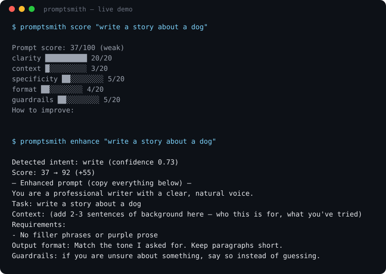

# 🔨 PromptSmith


[](https://realhassanabbasi.github.io/promptsmith/)

**Turn rough prompts into engineered ones.** Paste in *"help me with python"*, get back a structured prompt with a role, context slots, requirements, output format, and guardrails — scored before and after. Works **offline**, with **zero dependencies**.

## Try it in your browser

**[Live interactive demo →](https://realhassanabbasi.github.io/promptsmith/)** — the full engine (score, enhance, compare, intent classifier) running in the page. No install, no server.

## Why

Small vague prompts get small vague answers. PromptSmith applies the checklist every prompt-engineering guide agrees on — clarity, context, specificity, output format, guardrails — automatically. It even detects what you're trying to do with a Naive Bayes classifier written from scratch (no sklearn), so the enhancement fits the task.

## Features

- **`improve`** — the one-step loop: score, enhance, and re-score a prompt in one command — before/after table with per-check deltas, what improved, `--log`, `--save`, `--json`
- **`enhance`** — rewrite any rough prompt into a structured, engineered one (+40–55 points on average)
- **`score`** — grade a prompt 0–100 on 5 checks, with concrete fix-it feedback (`--json` for scripts)
- **`batch`** — score every prompt in a file (one per line): averages, weakest prompt, optional `--enhance` that writes `FILE.enhanced.md`
- **`compare`** — put two prompt versions head-to-head: scores, per-check deltas, a winner verdict, and what the loser should fix first (`--json` for scripts)
- **`history`** — log scored runs (`score`/`compare --log`) and print per-prompt trend reports (`report`): runs, averages, sparklines, and an improving/steady/slipping verdict (`--json` for dashboards)
- **`library`** — save named prompts as versioned library entries (`save NAME "prompt"`; `--improve` saves the enhanced version too): `library` lists each name's versions/last/best, `library NAME` shows its full version history — your best-scoring prompt is always one glance away (`--tags`, `--json`)
- **`templates`** — 8 fill-in-the-blank templates (debug code, explain concepts, learn vocabulary, study plans…)
- **`interactive`** — guided Q&A that builds your prompt with you
- **`skill`** — generate an installable agent skill (SKILL.md) from the real scoring rubric, so coding agents apply the same 5 checks themselves
- **From-scratch ML** — intent classifier (Multinomial Naive Bayes) trained on 94 labeled prompts across 8 intents, pure stdlib; shaky guesses fall back to a generic role instead of a confident wrong one
- **Zero dependencies** — only the Python standard library; runs anywhere, even offline

## Quickstart

```bash
# install straight from GitHub (verified clean install, zero dependencies)
pip install git+https://github.com/realhassanabbasi/promptsmith.git

# score a prompt
promptsmith score "help me with python"

# enhance it
promptsmith enhance "help me with python"

# or do both in one step — score, enhance, re-score, with proof
promptsmith improve "help me with python"

# score a whole list at once (one prompt per line)
promptsmith batch my_prompts.txt
promptsmith batch my_prompts.txt --enhance   # also enhances each, saves my_prompts.txt.enhanced.md

# machine-readable output for scripts and pipelines
promptsmith score "help me with python" --json
promptsmith enhance "help me with python" --json

# compare two versions of a prompt (whole file = one prompt)
promptsmith compare prompt_v1.txt prompt_v2.txt

# track scores over time, then see the trend
promptsmith score "help me with python" --log
promptsmith report

# save your best prompts as versioned library entries
promptsmith save py-help "help me with python" --tags coding,debug
promptsmith library

# guided mode
promptsmith interactive
```

Or run without installing:

```bash
git clone https://github.com/realhassanabbasi/promptsmith.git
cd promptsmith
python -m promptsmith score "help me with python"   # python -m promptsmith works too
```

Run the test suite:

```bash
python -m unittest discover -s tests -v
```

Python 3.9+ and you're good. A CI workflow for 3.10 / 3.11 / 3.12 ships with the
repo the moment it's added under `.github/workflows/` (see `.github/workflows/ci.yml`
in the source tree — GitHub Apps can't push workflow files, so this one goes in
by hand).

## Batch mode

Real output — a file with one prompt per line:

```
$ promptsmith batch my_prompts.txt

Scored 3 prompts from my_prompts.txt

   1.  37/100 (weak    ) help me with python
   2.  94/100 (excellent) Write a cover letter for a data science internship. …
   3.  61/100 (okay    ) explain recursion with an example

Average: 64.0/100
Weakest: "help me with python" (37/100)
```

`--enhance` also rewrites every prompt, reports the average gain, and saves all
enhanced prompts to `my_prompts.txt.enhanced.md`. `--json` on `score`, `enhance`
or `batch` prints machine-readable JSON for scripts and pipelines.

## Compare mode

Real output — two prompt versions, one question ("did my rewrite help?"):

```
$ promptsmith compare prompt_v1.txt prompt_v2.txt

Compare: prompt_v1.txt  vs  prompt_v2.txt

  A:  37/100 (weak     )  "help me with python"
  B:  94/100 (excellent)  "Write a guide to learning python for beginners.
Give m…"

Verdict: B wins by 57 points.

  check           A    B  delta
  clarity        20   20    +0
  context         3   14   +11
  specificity     5   20   +15
  format          4   20   +16
  guardrails      5   20   +15

Fix A first:
  • Too short to carry context. Add 2-3 sentences of background.
  • Be specific: names, numbers, versions, examples of what 'good' looks like.
  • Say what the answer should look like: bullets, table, code, steps…
  • Add one guardrail: tone, length limit, or 'say when unsure'.
```

`--json` gives the same comparison as machine-readable JSON
(`a`, `b`, `deltas`, `winner`, `margin`) for scripts and pipelines.

## Improve mode

Real output — the most common loop in one command (score → enhance → re-score):

```
$ promptsmith improve "help me with python"

Detected intent: code (confidence 0.38)
Score: 37 (weak) → 92 (excellent)  (+55)

  check        before  after  delta
  clarity          20     12     -8
  context           3     20    +17
  specificity       5     20    +15
  format            4     20    +16
  guardrails        5     20    +15

What improved: context (+17), format (+16), specificity (+15)

— Improved prompt (copy everything below) —

You are a senior software engineer who writes clean, well-commented code.

Task: help me with python

Context: (add 2-3 sentences of background here — who this is for, what you've tried)

Requirements:
- Handle edge cases
- Add brief comments on the tricky parts

Output format: Provide the code first, then a short explanation of how it works.
Guardrails: if you are unsure about something, say so instead of guessing.
```

It's honest about the trade too: the engineered prompt opens with a role
sentence, so `clarity` dips 20→12 while the total climbs 37→92.

`--log` records both the before and after runs in the score history
(`promptsmith report` shows them as a two-run trend), `--save FILE` writes
the improved prompt, and `--json` gives the full result
(`prompt`, `intent`, `before`, `after`, `deltas`, `margin`, `enhanced`)
for scripts and pipelines.

## Score history

Real output — log runs with `--log`, then watch trends with `report`:

```
$ promptsmith score "help me with python" --log

Prompt score: 37/100 (weak)

  clarity      ██████████  20/20
  context      █░░░░░░░░░   3/20
  specificity  ██░░░░░░░░   5/20
  format       ██░░░░░░░░   4/20
  guardrails   ██░░░░░░░░   5/20

How to improve:
  • Too short to carry context. Add 2-3 sentences of background.
  • Be specific: names, numbers, versions, examples of what 'good' looks like.
  • Say what the answer should look like: bullets, table, code, steps…
  • Add one guardrail: tone, length limit, or 'say when unsure'.

$ promptsmith report

Score history — 2 runs, 2 prompt(s) tracked

  prompt                                     runs   avg best last    Δ  trend   verdict
  help me with python                           1  37.0   37   37   +0  ▄       baseline —
  Write a Python function that sorts a lis…     1  58.0   58   58   +0  ▄       baseline —
```

Re-score the same prompt over days and the verdict column reads
`improving ▲`, `steady ▬`, or `slipping ▼` with a sparkline — the honest
answer to "are my prompts getting better?" `compare --log` logs both
versions. Records live in `.promptsmith/history.jsonl` (git-ignored), and
`report --json` gives the same table as JSON for dashboards.

## Prompt library

Real output — save prompts by name; re-saving adds a version:

```
$ promptsmith save py-help "help me with python" --tags coding,debug

Saved: py-help v1 — 37/100 (weak)
Tags: coding, debug
Library: /home/user/project/.promptsmith/library.jsonl

$ promptsmith save py-help --improve "write a python function that sorts a list"

Saved: py-help v2 — 92/100 (excellent)
Improved version saved too: 53/100 → 92/100.
  "You are a senior software engineer who writes clean, well-commented code. …"
Library: /home/user/project/.promptsmith/library.jsonl

$ promptsmith library

Prompt library — 2 version(s), 1 prompt(s) saved

  name                      ver last best    Δ  tags
  py-help                     2   92   92  +55▲  coding, debug

$ promptsmith library py-help

py-help — 2 version(s)

  ver score grade     saved
  v1   37/100 (weak    ) 2026-10-16
       "help me with python"
  v2   92/100 (excellent) 2026-10-16
       "write a python function that sorts a list"
       → improved: "You are a senior software engineer who writes clean, well-commen…"
```

The library answers "which version of my prompt is the best?" — `library`
lists every name's last/best score and the Δ since the first save, `library NAME`
shows the full version history. Records live in `.promptsmith/library.jsonl`
(git-ignored, same folder as score history), and `--json` gives the same data
for scripts. `--improve` saves both the original and its enhanced rewrite,
with the before→after proof stored on the record.

## Agent skill export

Coding agents (Claude Code, Codex, Cursor) can use PromptSmith's rubric
directly — no CLI calls needed:

```bash
# print the skill, or write it to a skills folder:
promptsmith skill
promptsmith skill --out ~/.claude/skills
```

This writes `~/.claude/skills/promptsmith/SKILL.md`: the 5-check rubric
(clarity, context, specificity, format, guardrails — 20 points each), all 8
intent roles with their formats, and a real worked example. The skill is
generated from the actual code, so it always matches the current version —
nothing to keep in sync by hand.

## Demo



Real output, copied from the terminal — no mockups:

```
$ promptsmith score "help me with python"

Prompt score: 37/100 (weak)

  clarity      ██████████  20/20
  context      █░░░░░░░░░   3/20
  specificity  ██░░░░░░░░   5/20
  format       ██░░░░░░░░   4/20
  guardrails   ██░░░░░░░░   5/20

How to improve:
  • Too short to carry context. Add 2-3 sentences of background.
  • Be specific: names, numbers, versions, examples of what 'good' looks like.
  • Say what the answer should look like: bullets, table, code, steps…
  • Add one guardrail: tone, length limit, or 'say when unsure'.
```

```
$ promptsmith enhance "help me with python"

Detected intent: code (confidence 0.38)
Score: 37 → 92  (+55)

— Enhanced prompt (copy everything below) —

You are a senior software engineer who writes clean, well-commented code.

Task: help me with python

Context: (add 2-3 sentences of background here — who this is for, what you've tried)

Requirements:
- Handle edge cases
- Add brief comments on the tricky parts

Output format: Provide the code first, then a short explanation of how it works.
Guardrails: if you are unsure about something, say so instead of guessing.
```

More pairs in [`examples/before_after.md`](examples/before_after.md).

## How the scoring works

| Check (20 pts each) | What it looks for |
|---|---|
| Clarity | Opens with a clear action verb (write, explain, analyze…) |
| Context | Enough background — who, what, what you've tried |
| Specificity | Concrete details: names, numbers, versions |
| Format | Says what the answer should look like (bullets, table, code…) |
| Guardrails | Tone, length limits, "say when unsure" |

## Architecture

```
                        +------------------+
                        |      cli.py      |  argparse: score / enhance / batch /
                        +--------+---------+    templates / interactive /
                                 |                skill / compare / report /
                                                  improve / save / library
            +--------------------+--------------------+
            |                    |                    |
     +------v------+      +------v------+      +------v------+
     | classifier  |      |   scorer    |      |  enhancer   |
     | Naive Bayes |      | 5-check     |      | intent ->   |
     | from scratch|      | rubric 0-100|      | role, reqs, |
     +------+------+      +------+------+      | format,     |
            |                    |             | guardrails  |
   training_prompts.json         |             +------+------+
   (94 labeled prompts,          +----> before/after scores -+
    8 intents)              compare reuses the scorer for A vs B
```

Design decisions, stated plainly:

- **From-scratch Naive Bayes instead of sklearn** — the math is ~60 lines and fully auditable, and it keeps the tool at zero dependencies. For 8 intents and 94 examples, a hand-rolled classifier is the right-sized tool, not a shortcut.
- **Low-confidence fallback instead of confident wrong guesses** — when intent confidence drops below 0.35, the enhancer uses the generic `chat` role rather than the top guess. A wrong role and format actively harms the output; an honest generic one doesn't.
- **Zero dependencies as a hard constraint** — the audience is students on free tiers. `pip install` should never pull a dependency tree, and the tool must run offline.
- **Rule-based scorer, not an LLM judge** — deterministic, instant, explainable. The point is teaching prompt craft, so the feedback must be inspectable. The honest cost of this choice is in Limitations below.
- **Enhancement by gap-filling, not rewriting** — the enhancer wraps *your* task text with a role, requirements, format and guardrails instead of replacing your intent. Your words stay yours.

## Limitations

Honest ones, verified against the code:

- **English only.** The tokenizer keeps `[a-z]+` and every scoring keyword list is English. Non-English prompts will score badly and misclassify — that's the tool's boundary, not yours.
- **Tiny training set.** 94 labeled prompts across 8 intents (10–16 per intent). Holdout accuracy (last example per intent, retrained) is 6/8 — both misses were low-confidence guesses, exactly the case the 0.35 fallback now catches by using the generic `chat` role. Unusual prompts will still misclassify; that's the tool's boundary, not yours.
- **Scores are heuristic, not measured.** The rubric is a hand-written checklist. The "37 → 92" gain is computed by the *same* scorer that shaped the enhancement — self-reported progress, not an independent measurement of answer quality.
- **No model calls, ever.** PromptSmith never talks to an LLM, so it can't verify that an enhanced prompt actually gets better answers. That final check is yours.
- **Terminal needed for two modes.** `interactive` and `templates --show` read from `input()` — they need a real terminal, not a pipe.

## Project structure

```
promptsmith/
├── .github/
│   └── workflows/
│       └── ci.yml           # tests on Python 3.10 / 3.11 / 3.12
│                            # (add by hand — GitHub Apps can't push workflow files)
├── promptsmith/
│   ├── __init__.py        # public API
│   ├── __main__.py        # `python -m promptsmith`
│   ├── cli.py             # argparse CLI (score/enhance/batch/templates/interactive/skill/compare/report/improve/save/library)
│   ├── classifier.py      # Naive Bayes intent classifier, from scratch (+0.35 fallback)
│   ├── compare.py         # `promptsmith compare` — head-to-head, per-check deltas
│   ├── enhancer.py        # enhancement pipeline (role → structure → guardrails)
│   ├── history.py         # `score/compare --log` + `promptsmith report` — score history & trends
│   ├── improve.py         # `promptsmith improve` — score, enhance, re-score in one step
│   ├── library.py         # `promptsmith save` + `promptsmith library` — versioned prompt library
│   ├── scorer.py          # 5-check rubric, 0-100
│   ├── skills.py          # `promptsmith skill` — renders an installable agent skill
│   ├── templates.py       # 8 ready-made templates
│   └── data/
│       └── training_prompts.json  # labeled set (94 prompts, 8 intents)
├── tests/
│   └── test_promptsmith.py  # 70 unit tests (scorer, classifier, enhancer, CLI, batch, packaging, skill, compare, history, improve, library)
├── examples/
│   └── before_after.md    # real before/after pairs
├── demo.py                # end-to-end demo, no args needed
├── pyproject.toml
└── LICENSE                # MIT
```

## Tech stack

Python 3.9+ · standard library only · unittest

## Author

**Hassan Abbasi** — AI Engineer. I build AI-powered products with excellent user experiences.
